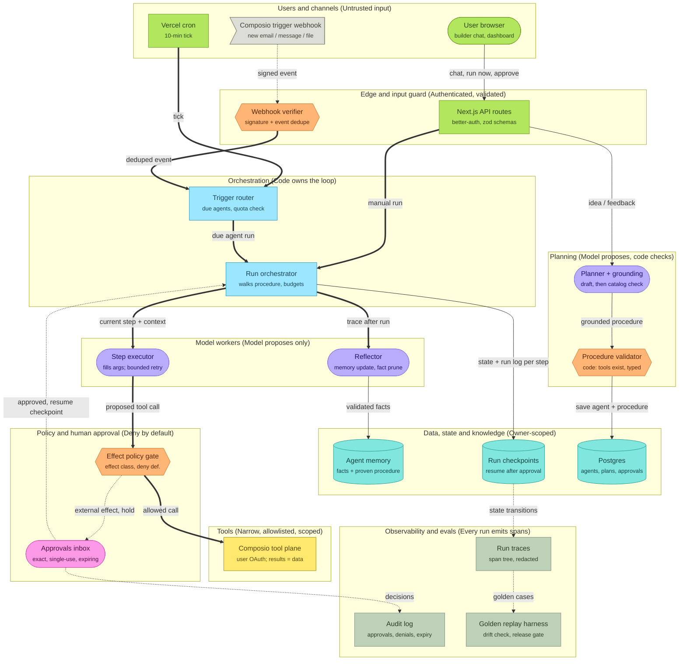

# AgentDock architecture

> Designed with Agentic Architect (A-Z of Agentic AI). Diagram: see `architecture.mmd` / `architecture-preview.svg` (Miro board pending connection). Machine-readable twin: `architecture.json`.

## 1. Goal and scope
- **User and journey:** A non-technical user describes an automation in plain language; AgentDock plans it against real tool capabilities, the user approves, connects accounts via managed OAuth, trains the agent to one verified success, and it runs on schedules or real-time events with run-based billing.
- **Done means:** an approved, trained agent whose runs complete with verified outcomes (trace evidence matches the claim) within budgets, with external effects either auto-run (owner choice) or approved exactly.
- **Supported requests:** single-agent automations across ~100 managed-auth apps + built-in web research; daily/hourly schedules; real-time triggers for event-capable apps; owner approval for outbound actions.
- **Non-goals:** multi-agent crews or A2A; drag-and-drop builder; arbitrary code execution tools; self-hosted per-app OAuth in this phase.

## 2. Autonomy (Ch1, Ch24)
Level: **hybrid** overall.

| Decision | Chosen by | Why |
|---|---|---|
| What the workflow is (procedure) | Model drafts, **user approves**, code validates | plan is checkable before spending (Ch13) |
| Next step during a run | **Code** (procedure walker) | steps are enumerable after grounding (Ch24) |
| Arguments for the current step | Model | messy-language slot filling (Ch24) |
| Recovery when a step fails | Model, inside a bounded loop | genuinely observation-dependent (Ch13) |
| Whether a side effect executes | **Code** (effect gate) + human for external classes | irreversible commitments behind deterministic code (Ch24) |
| When to stop | Code: budgets + named stop reasons | (Ch14) |

## 3. Pattern decisions
| # | Decision | Choice | Reason | Chapter | Rejected alternative |
|---|---|---|---|---|---|
| D1 | Autonomy | Hybrid; approval for external effects | least autonomy that works | Ch1, Ch24 | free agent loop (current build) |
| D2 | Workflow vs agent | Plan-execute: code walks procedure | steps enumerable after grounding | Ch24 | prose playbook + free ReAct |
| D3 | Reasoning | Plan-execute top, bounded ReAct recovery, deterministic verifier | plan checkable; trace-vs-claim check | Ch13 | model self-verification |
| D4 | Agents | One agent per run; model roles not crew | no named reason to split | Ch31 | planner/runner/critic crew |
| D5 | Tools | Composio plane behind per-agent allowlist failing closed + effect classification | narrow, typed, scoped | Ch11, Ch29 | raw tool list exposure |
| D6 | RAG | None; tool catalog is structured data | facts live in DB/tool calls | Ch17 | embedding the catalog |
| D7 | Memory/state | Checkpoints (new) + episodic logs + semantic/procedural memory | separate stores, owners | Ch18, Ch19 | single prose memory blob |
| D8 | Guardrails | Layered: edge schema, allowlist, effect gate deny-by-default, outcome verifier | each layer independent | Ch48 | regex intercept only |
| D9 | HITL | Exact-action approvals, single-use, expiring; resume via checkpoint | approve actions, not agents | Ch49 | approve-the-agent toggle only |
| D10 | Reliability | Timeouts, transient/permanent classes, webhook dedupe, idempotent resume | side effects never repeat | Ch14, Ch53 | retry-on-anything |
| D11 | Evals | Golden cases from training runs, weekly replay, red-team ledger, release gate | drift detection from reality | Ch41-45 | no eval harness (current) |
| D12 | Deploy/cost | Serverless + checkpointed resume; model routing nano-first | fits Vercel; cost per run bounded | Ch51-52 | long-running workers |

## 4. Components
| Layer | Component | Kind | Responsibility | Owner |
|---|---|---|---|---|
| Users and channels | User browser | actor | builder chat, dashboard, approvals | user |
| Users and channels | Composio trigger webhook | external | real-time app events | Composio |
| Users and channels | Vercel cron | interface | 10-minute tick | platform |
| Edge | Next.js API routes | interface | auth, zod-typed bodies, ownership checks | platform |
| Edge | Webhook verifier | guardrail | HMAC signature + webhook-id dedupe | platform |
| Planning | Planner + grounding | agent | idea -> plan; catalog-grounded procedure | platform |
| Planning | Procedure validator | guardrail | code check: every tool slug exists, typed | platform |
| Orchestration | Run orchestrator | orchestrator | walks procedure, budgets, stop reasons, checkpoints | platform |
| Orchestration | Trigger router | orchestrator | due agents, quota, backoff | platform |
| Model workers | Step executor | agent | fills args for the current step; bounded recovery | platform |
| Model workers | Reflector | agent | memory distillation, fact pruning | platform |
| Policy | Effect policy gate | guardrail | classify effect, deny by default | platform |
| Policy | Approvals inbox | human | exact, single-use, expiring approvals | user |
| Tools | Composio tool plane | tool | per-user OAuth accounts; built-in research | Composio |
| Data | Postgres | data | users, agents, plans, approvals, runs | platform |
| Data | Run checkpoints | data | step-by-step state, resume | platform |
| Data | Agent memory | data | semantic facts + proven procedure | platform |
| Observability | Run traces | observability | span tree per run, redacted | platform |
| Observability | Audit log | observability | approvals, denials, expiries | platform |
| Observability | Golden replay harness | observability | drift check, release gate | platform |

## 5. Data flows
See `architecture.json` edges. Untrusted flows: webhook event payloads, tool results, web content -> always data, never instructions.

## 6. Trust boundaries and checkers (Ch46, Ch62)
| Boundary | What crosses | Checker (code) | On failure |
|---|---|---|---|
| Browser -> API | user requests | better-auth session + zod schema + ownership | 401/400, logged |
| Webhook -> router | trigger events | HMAC verify + webhook-id dedupe | 401 / silent dedupe |
| Model -> tools | proposed calls | per-agent allowlist (fails closed) + effect gate | DENIED stop reason, surfaced |
| Tools/web -> model | results, pages, emails | untrusted-data labelling + injection rule | n/a (data only) |

## 7. Tool contracts (Ch11, Ch48)
One envelope (Composio: successful/data/error normalized). Per-agent allowlist = procedure tools + read-only research set. Effect classes: read (auto) / internal write (auto) / external message, money, delete (approval unless owner opted out; unknown -> deny). Timeout per call; truncation at 12k chars; results labelled untrusted.

## 8. State, memory and checkpoints (Ch18, Ch19)
| Store | Holds | Owner scope | Retention | Deletion |
|---|---|---|---|---|
| Postgres (core) | users, agents, plans+procedures, approvals | per user | account life | cascade on delete |
| Run checkpoints | per-run step state, pending action | per run | until run settles + 7d | with run |
| Run logs/traces | episodic history | per user | account life | with agent |
| Agent memory | semantic facts (provenance), proven procedure | per agent | capped 2.5k chars | with agent |

## 9. Human approval points (Ch49)
| Action | Approver | Evidence shown | Expiry | On timeout |
|---|---|---|---|---|
| External effect (ask-first agents) | owner | exact tool + full payload | 72h | no effect; run FAILED(WAITING_EXPIRED); notice |
| Plan approval | owner | full plan + procedure + setup | n/a | agent not created |
| Training graduation | system-verified | successful trace | n/a | stays draft |

## 10. Failure handling (Ch14, Ch53)
- Budgets: step budget per run, bounded recovery retries per step, token budget per run.
- Stop reasons: DONE, FAILED, STEP_BUDGET, TOKEN_BUDGET, LOOP_DETECTED, WAITING_APPROVAL, DENIED, SKIPPED_PRECONDITION.
- Retries: transient only, once, backoff; scope/permission errors permanent. Circuit: cron backoff for broken agents.
- Escalation: failures surface honestly in run log + dashboard; approval expiry notifies.

## 11. Evaluation and observability (Ch41-45)
- Dimensions: task success (outcome verifier), tool accuracy (procedure adherence), efficiency (steps/tokens), safety (zero unapproved external effects vs audit log).
- Golden set: frozen successful training runs per agent; platform red-team ledger (injection, scope errors, empty results).
- Tracing: span tree per run, redacted; audit log for approvals/denials/expiries.
- Release gate: replay golden set before deploy; PROMOTE only with zero safety regressions.

## 12. Cost and latency (Ch52)
Runs are background (seconds-to-minutes). Cheapest model walks steps; training ladder escalates. Levers: procedure replay (fewer exploration calls), result truncation, per-run token budget, model routing.

## 13. Risks and owners (Ch46, Ch59)
| Risk | Impact x likelihood | Prevent / detect / correct | Owner |
|---|---|---|---|
| Prompt injection steering tools | high x medium | effect gate + approvals / audit + red-team / revoke + retrain | platform |
| Composio dependency | high x low | abstract tool plane / monitor / per-app OAuth or vendor MCP exit | founder |
| Serverless time ceiling | medium x medium | checkpointed resume / stop reasons / resume next tick | platform |
| Approval rubber-stamping | medium x medium | full payload shown / audit sampling / UX friction for big effects | product |
| Memory poisoning | medium x low | trace-validated reflection / fact pruning / memory reset | platform |

## 14. Open questions
- Notification channel for approvals/failures (email vs WhatsApp) - next feature decision.
- Trigger config picker (16 apps needing board/repo/channel selection) - extends event coverage 14 -> 30 apps.
- When run volume justifies direct OAuth for Gmail/Instagram vs staying fully managed.

## Diagram

